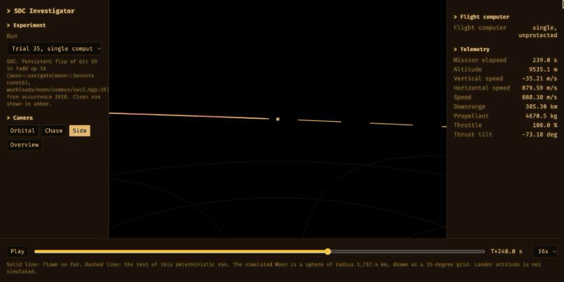
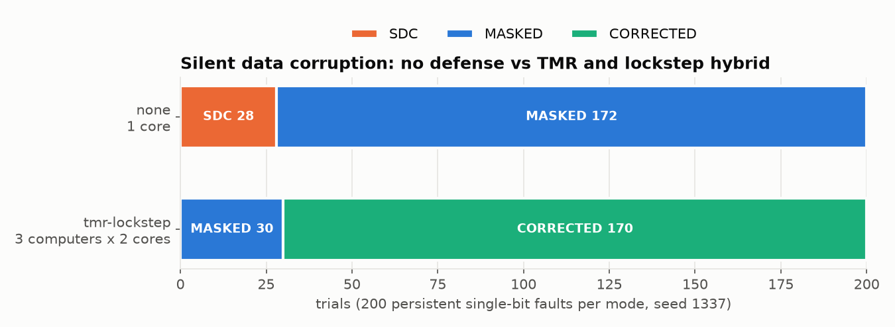
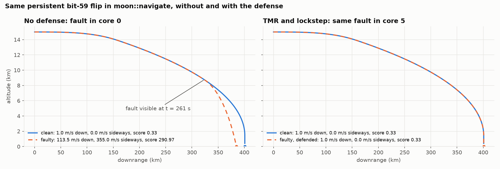
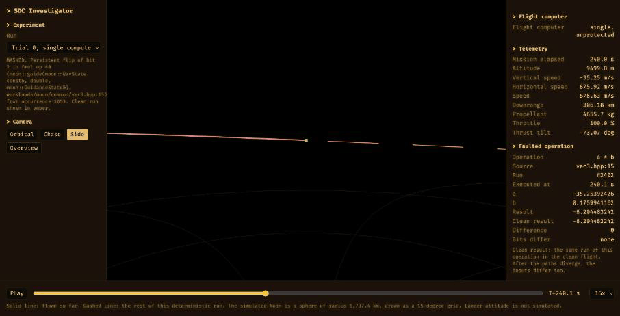
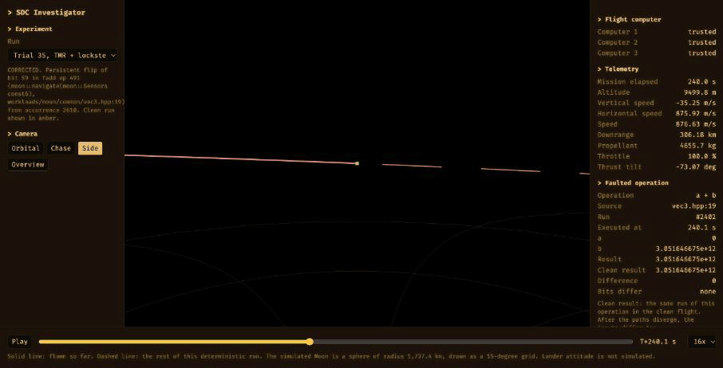

## SDC Investigator

Flip one bit in one floating-point result inside a compiled C++ program, then trace bit for bit whether the damage is masked, caught by a defense, or silently changes the answer.



On a lunar landing computer, one persistent bit flip in the flight software silently ruins the landing in 28 of 200 trials. A TMR and lockstep flight-computer design, modeled on real rocket avionics, brings that to 0 of 200 when the fault stays in one core. Faults that hit several computers at once are not measured yet.

An LLVM IR pass rewrites every double-precision add, subtract, multiply, divide, and square root into a runtime hook. The runtime records each operation in a bit-exact binary trace and can flip one bit of one result: once (transient), or on every later execution of that operation (persistent, like a defective core). The analyzer compares a clean run against an injected run and classifies the outcome as MASKED, SDC, DETECTED, CORRECTED, CRASH, HANG, or INCONCLUSIVE, with evidence that cites the events behind the verdict.

## The demo

A Lunar Module class lander descends from a 15 km lunar orbit to touchdown. Its flight software (FSW) is built at -O2 and instrumented: navigation and guidance. The physics plant is not instrumented. Each run is judged on the true touchdown state against the landing-gear envelope.

| Experiment | Result |
|---|---|
| Clean landing | Touchdown at 527.8 s, 1.0 m/s down, 0.0 m/s sideways, 1,158 kg propellant left |
| 200 transient faults, no defense | 200 MASKED: the control loop corrects one bad tick on the next |
| 200 persistent faults, no defense | 28 SDC (14%), 172 MASKED: 172 safe landings |
| 200 persistent faults, TMR and lockstep hybrid | 0 SDC, 170 CORRECTED, 30 MASKED: 200 safe landings |

The defense mimics real rocket flight computers: three computers, each a lockstep pair of cores, with commands compared across computers.

<picture>
  <source media="(prefers-color-scheme: dark)" srcset="docs/img/defense_outcomes_dark.png">
  
</picture>

With no defense, about one in seven persistent single-bit faults silently ruins the landing: 20 crash and 8 touch down softly but more than 1 km off target. With the defense, all 200 land safely: in 170 the defense silenced or outvoted the broken core, and in 30 the fault was absorbed before it could change the engine command.

<picture>
  <source media="(prefers-color-scheme: dark)" srcset="docs/img/same_fault_dark.png">
  
</picture>

The same persistent exponent flip in navigation (trial 35), side by side. Without a defense (left) the trajectories match until t = 261 s, then the lander falls short and strikes the surface 16 km from the clean landing spot. With the defense (right) the fault lands on one core of one computer, which is silenced, and the landing matches the clean one.

### Viewer

The web display replays the featured trials from the side of the flight plane. Clean runs are amber, faulty runs red.

MASKED, no defense (trial 0): the fault never changes the trajectory.



CORRECTED, TMR and lockstep (trial 35): one computer is silenced at 261 s and the landing matches the clean run.



## Build

Requires Homebrew LLVM 23 (`/opt/homebrew/opt/llvm`), CMake, Ninja, GoogleTest 1.18, and Python 3.14.

```bash
cmake -S . -B build -G Ninja \
  -DCMAKE_C_COMPILER=/opt/homebrew/opt/llvm/bin/clang \
  -DCMAKE_CXX_COMPILER=/opt/homebrew/opt/llvm/bin/clang++
ninja -C build
ctest --test-dir build
```

`-DSDC_BUILD_TESTS=OFF` builds without GoogleTest. On Linux, `.github/workflows/ci.yml` shows the setup with LLVM 23 from apt.llvm.org; set `LLVM_ROOT=/usr/lib/llvm-23` for `tools/instrument.sh`.

## Run the lander

```bash
./tools/instrument.sh --name moon -I workloads/moon/common -I workloads/moon/plant \
  --replicate 6 --replicate-entry run_core --replicated workloads/moon/fsw/core.cpp \
  --replicated workloads/moon/fsw/navigation.cpp --replicated workloads/moon/fsw/guidance.cpp \
  --instrument workloads/moon/fsw/fsw.cpp --instrument workloads/moon/fsw/redundancy.cpp \
  --plain workloads/moon/sim/main.cpp --plain build/workloads/moon/plant/libmoon_plant.a \
  --keep fsw_tick --keep fsw_configure -o build/moon/moon_instr

/opt/homebrew/bin/python3.14 tools/study/sweep.py --binary build/moon/moon_instr --ops build/moon/ops.json \
  --trials 200 --seed 1337 --workload moon --persistent \
  --build-id <id printed by instrument.sh> \
  --compiler-flags "-O2 -gline-tables-only -ffp-contract=off -fno-vectorize -fno-slp-vectorize" \
  --analyzer-args "--reference-bits 0x0 --abs-tol 1" --forward-from-clean spot:--reference \
  --jobs 8 --out results/sweep_moon_persistent_none -- --defense none
```

Use `-- --defense tmr-lockstep` for the defended run.

## View a run

```bash
cd web && npm ci && npm run dev
```

The display plays committed data for the featured trials, so it needs no native build. `npm run prepare-data` regenerates `web/public/data/` from `build/moon/moon_instr` and the stored sweeps.

The viewer in `web/` was generated with an AI assistant and not reviewed line by line. The project's focus is the fault injection and analysis, not the visuals.

## Plot the figures

```bash
/opt/homebrew/bin/python3.14 -m venv .venv && .venv/bin/pip install matplotlib==3.11.2
.venv/bin/python tools/plot.py --binary build/moon/moon_instr --trial 35 --out docs/img
```

## Documents

| Document | What it is |
|---|---|
| [`docs/architecture.md`](docs/architecture.md) | The living spec. |
| [`docs/architecture-v1.md`](docs/architecture-v1.md) | The frozen original blueprint. Never edited. |
| [`docs/audit-log.md`](docs/audit-log.md) | Every architectural decision, with its evidence. |
| [`docs/trace-format.md`](docs/trace-format.md) | Normative specification of the binary `SDCTRACE` trace format. |
| [`docs/math/moon-mission-math.pdf`](docs/math/moon-mission-math.pdf) | The mathematics of the lander's plant, navigation, guidance, and judge. |
| [`STATE.md`](STATE.md) | Current state, measurements, and the next move. |

## Background

Two NASA space computing papers shaped the defense model and the question of where to harden:

- [Enhancing Fault-Tolerant Space Computing: GNC and LVS Implementations on Next-Gen Multi-Core Processors](https://arxiv.org/abs/2511.04052) (Yun et al., 2025) introduces ARBITER, a multi-core voting mechanism that detects and corrects faults across redundant cores, and reports a bit-level fault injection study that found the most sensitive stage of a guidance algorithm.
- [NASA's HPSC white paper](https://www.nasa.gov/wp-content/uploads/2024/07/hpsc-white-paper-tmg-26jun2024-final.pdf) documents the dual core lockstep configuration: two cores form a lockstep domain, their outputs are compared every clock cycle, and any difference is flagged immediately.

## Design principles

- The deterministic layer is the source of truth. The analyzer decides the outcome.
- Every quantitative claim is auditable against the raw trace.
- Fully offline. No network, no credentials, no external services.
- Workload source stays plain. Zero annotations or macros in the instrumented code.
- Bit-exact records. Raw IEEE-754 bit patterns, never decimal text.
- Reproducible everything. Same sources and flags give identical operation numbering, and two clean runs give byte-identical traces.
