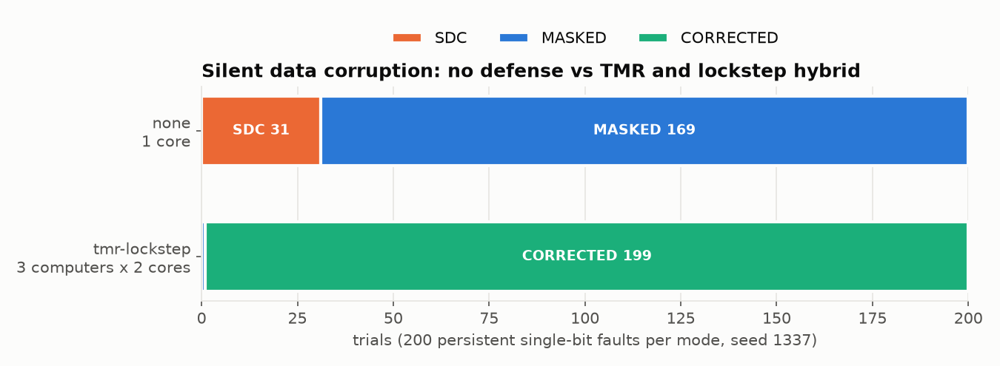
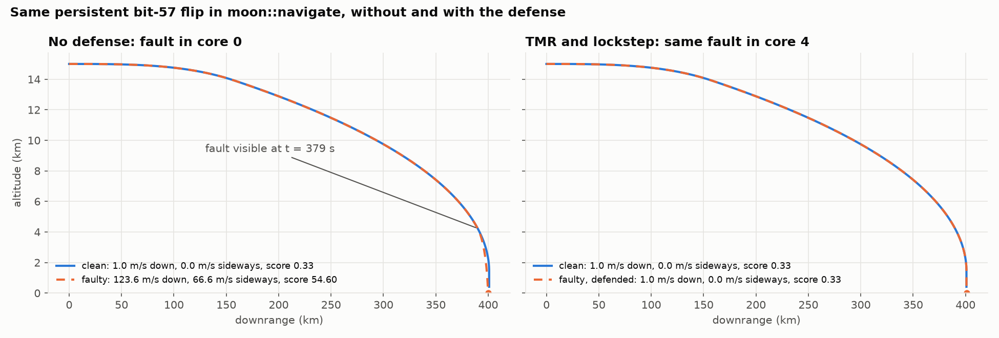
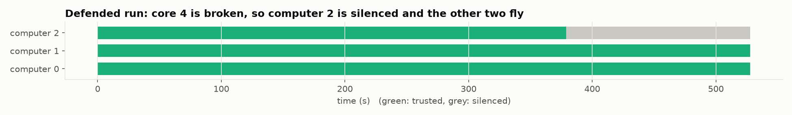
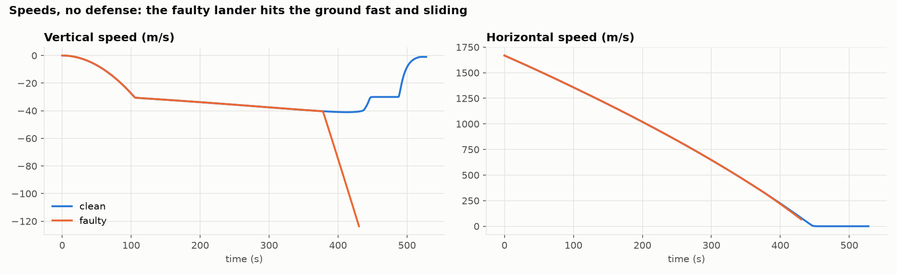

# SDC Investigator

An offline, deterministic platform for studying silent data corruption (SDC) in numerical C++ programs, demonstrated on a lunar landing computer.

An LLVM IR pass rewrites every double-precision add, subtract, multiply, divide, and square root into a runtime hook. The runtime records each operation in a bit-exact binary trace and can flip one bit of one result, either once (transient) or on every later execution of that operation (persistent, like a defective core). The analyzer compares a clean run against an injected run and classifies the outcome as MASKED, SDC, DETECTED, CORRECTED, CRASH, HANG, or INCONCLUSIVE, with an evidence package that cites the events behind the verdict.

## The demo

A Lunar Module class lander descends from a 15 km lunar orbit to touchdown. Its flight software (navigation and guidance) is instrumented; the physics plant is not. Each fault-injection run is judged on the true touchdown state against the Lunar Module's landing-gear envelope.

| Experiment | Result |
|---|---|
| Clean landing | Touchdown at 527.8 s, 1.0 m/s down, 0.0 m/s sideways, 1,158 kg propellant left |
| 200 transient faults, no defense | 200 MASKED: the control loop corrects one bad tick on the next |
| 200 persistent faults, no defense | 31 SDC (15.5%), 169 MASKED: 169 safe landings |
| 200 persistent faults, TMR and lockstep hybrid | 0 SDC, 199 CORRECTED, 1 MASKED: 200 safe landings |

The defense is a hybrid of TMR and lockstep that mimics real rocket flight computers: three computers, each a lockstep pair of cores, with commands compared across computers.

## Results

<picture>
  <source media="(prefers-color-scheme: dark)" srcset="docs/img/defense_outcomes_dark.png">
  
</picture>

With no defense, about one in six persistent single-bit faults silently crashes the lander. With the TMR and lockstep hybrid, all 200 land safely: in 199 the defense silenced or outvoted the broken core.

<picture>
  <source media="(prefers-color-scheme: dark)" srcset="docs/img/same_fault_dark.png">
  
</picture>

The same persistent exponent flip in navigation (trial 1), side by side. Without a defense (left) the trajectories match until t = 379 s, then the lander falls short and strikes the surface at 123.6 m/s. With the defense (right) the same fault lands on core 4 and the landing is identical to the clean one.

<picture>
  <source media="(prefers-color-scheme: dark)" srcset="docs/img/computers_dark.png">
  
</picture>

What the defense did: core 4's two-core computer (computer 2) disagrees with itself from t = 379 s, so it is silenced and computers 0 and 1 fly the rest of the descent.

<picture>
  <source media="(prefers-color-scheme: dark)" srcset="docs/img/descent_speeds_dark.png">
  
</picture>

The undefended run's speeds: the fault takes over late in braking, where vertical speed should level off before the final descent.

## Build

Requires Homebrew LLVM 23 (`/opt/homebrew/opt/llvm`), CMake, Ninja, GoogleTest 1.18, and Python 3.14.

```bash
cmake -S . -B build -G Ninja \
  -DCMAKE_C_COMPILER=/opt/homebrew/opt/llvm/bin/clang \
  -DCMAKE_CXX_COMPILER=/opt/homebrew/opt/llvm/bin/clang++
ninja -C build
ctest --test-dir build
```

`-DSDC_BUILD_TESTS=OFF` builds without GoogleTest.

## Run the lander

```bash
./tools/instrument.sh --profile o0 --name moon -I workloads/moon/common -I workloads/moon/plant \
  --replicate 6 --replicate-entry run_core --replicated workloads/moon/fsw/core.cpp \
  --replicated workloads/moon/fsw/navigation.cpp --replicated workloads/moon/fsw/guidance.cpp \
  --instrument workloads/moon/fsw/fsw.cpp --instrument workloads/moon/fsw/redundancy.cpp \
  --plain workloads/moon/sim/main.cpp --plain build/workloads/moon/plant/libmoon_plant.a \
  --keep fsw_tick --keep fsw_configure -o build/moon/moon_instr

/opt/homebrew/bin/python3.14 tools/study/sweep.py --binary build/moon/moon_instr --ops build/moon/ops.json \
  --trials 200 --seed 1337 --workload moon --persistent \
  --analyzer-args "--reference-bits 0x0 --abs-tol 1" --forward-from-clean spot:--reference \
  --jobs 8 --out results/sweep_moon_persistent_none -- --defense none
```

Use `-- --defense tmr-lockstep` for the defended run.

## View a run

```bash
/opt/homebrew/bin/python3.14 tools/view.py --binary build/moon/moon_instr \
  --sweep results/sweep_moon_persistent_none --trial 1 --defense none --out view_trial1.html
```

The generator re-flies the clean landing and the chosen trial (runs are deterministic) and writes one offline HTML file: the 3D descent with clean and faulty paths, the fault and outcome, the three flight computers' status over time, and altitude and speed charts on a shared timeline.

## Plot the figures

```bash
/opt/homebrew/bin/python3.14 -m venv .venv && .venv/bin/pip install matplotlib==3.11.2
.venv/bin/python tools/plot.py --binary build/moon/moon_instr --trial 1 --out docs/img
```

## Documents

| Document | What it is |
|---|---|
| [`docs/architecture.md`](docs/architecture.md) | The living spec. |
| [`docs/architecture-v1.md`](docs/architecture-v1.md) | The frozen original blueprint. Never edited. |
| [`docs/audit-log.md`](docs/audit-log.md) | Every architectural decision, with its evidence. |
| [`docs/trace-format.md`](docs/trace-format.md) | Normative specification of the binary `SDCTRACE` trace format. |
| [`docs/math/moon-mission-math.pdf`](docs/math/moon-mission-math.pdf) | The mathematics of the lander's plant, navigation, guidance, and judge. |
| [`STATE.md`](STATE.md) | Current state, measurements, and the next move. |

## How changes happen

1. Edit `docs/architecture.md`.
2. Record the decision in `docs/audit-log.md`: add an entry for a new decision, or rewrite the existing entry when a decision changes. Git history keeps earlier versions.
3. Record the decision ID in the tables in `docs/architecture.md`.

## Design principles

- The deterministic layer is the source of truth. The analyzer decides the outcome.
- Every quantitative claim is auditable against the raw trace.
- Fully offline. No network, no credentials, no external services.
- Workload source stays plain. Zero annotations or macros in the instrumented code.
- Bit-exact records. Raw IEEE-754 bit patterns, never decimal text.
- Reproducible everything. Same sources and flags give identical operation numbering, and two clean runs give byte-identical traces.
